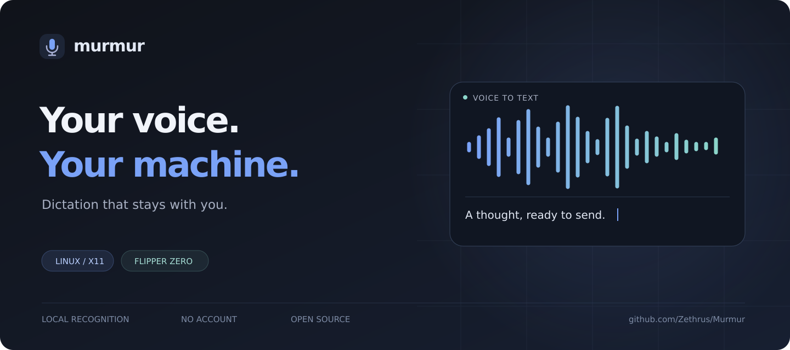

<p align="center">
  
</p>

<p align="center">
  <a href="https://github.com/Zethrus/Murmur/releases/latest">Download for Linux</a> ·
  <a href="companion/README.md">Flipper Zero setup</a> ·
  <a href="docs/building.md">Build from source</a> ·
  <a href="docs/roadmap.md">What's next</a>
</p>

<p align="center">
  <a href="https://github.com/Zethrus/Murmur/actions/workflows/release.yml"></a>
  <a href="https://github.com/Zethrus/Murmur/releases/latest"></a>
  <a href="LICENSE"></a>
</p>

Murmur turns speech into text in the application you're using. Hold **Ctrl+Alt+D**,
speak, and release. Recognition runs on your computer. There is no account,
subscription, or cloud transcription service.

Use it for messages, notes, editor prompts, or code. A small overlay shows the
transcript as it arrives. The optional Flipper Zero app gives you a physical
push-to-talk button and a screen for live text.

## What ships today

**Linux x86_64 and the Flipper Zero companion.** Current prebuilt downloads use
Ubuntu 24.04 as their build baseline and require **glibc 2.39 or newer**, a working Linux desktop, and hardware drivers. On older distributions, build from source. Use an X11
desktop with a working microphone and system tray. Native Wayland input is not verified.

| Download | Use it for |
| --- | --- |
| `.deb` | Debian/Ubuntu installation with the application runtime included |
| `.AppImage` | Recommended portable download, with runtime and typing tools included |
| `murmur-linux-x86_64.tar.gz` | A portable directory containing the app and its engine |
| `murmur-companion-vX.Y.Z.fap` | The Flipper Zero remote, matched to the desktop version |
| `SHA256SUMS` | Checking that the downloaded files match the release |

[Get the latest release](https://github.com/Zethrus/Murmur/releases/latest).
The separate `murmur` download is the same AppImage. `murmur-engine` is also
available for command-line integrations; it needs an external CUDA userspace
runtime for GPU use. Linux desktop packages built from this checkout include
their own runtime. Published 0.4.2 downloads predate this packaging change.

The Android APK is planned for **November 6, 2026**. Windows builds are deferred
until **November 6 or 7**. These are targets, subject to
build and device testing. Neither platform is included in today's release.
See [the roadmap](docs/roadmap.md).

## Install and dictate

Download a package and `SHA256SUMS` from the same release. In that directory:

```sh
sha256sum --check --ignore-missing SHA256SUMS
```

For Debian/Ubuntu, install the downloaded `.deb`:

```sh
sudo apt install ./Murmur_*_amd64.deb
murmur
```

For the AppImage:

```sh
chmod +x Murmur_*_amd64.AppImage
./Murmur_*_amd64.AppImage
```

If FUSE is unavailable, try `./Murmur_*_amd64.AppImage --appimage-extract-and-run`.
`xdotool`, `xprop`, WebKitGTK, GTK, and the audio client libraries are bundled.
No Python installation or separate typing utilities are needed.

For the portable archive:

```sh
mkdir murmur-portable
tar -xzf murmur-linux-x86_64.tar.gz -C murmur-portable
./murmur-portable/murmur
```

The portable archive includes the same AppImage as `murmur`. If FUSE is
unavailable, run `./murmur-portable/murmur --appimage-extract-and-run`.
The host still provides glibc, the X11 desktop, audio services, and hardware drivers. On GNOME, enable a tray/AppIndicator extension if your
shell does not show tray icons.

1. Launch Murmur to open **Settings**. Starting at login runs quietly in the tray.
2. In **Engine**, install a speech model, then choose **Use model**. `distil-small.en` is a useful starting point for English.
3. In **Audio**, select your microphone.
4. Focus a text field. Hold **Ctrl+Alt+D**, speak, then release.

Press **Esc** while recording to cancel. For hands-free recording, switch the
hotkey to **Toggle** in General. Closing Settings keeps Murmur running; choose
**Quit** from the tray menu to exit.

Models download only when you choose Install. After that, speech recognition
works offline. Downloads include a Python runtime, so Python, Rust and Node are
not needed to run them. New desktop builds include pinned CUDA userspace libraries;
a compatible host NVIDIA driver is required for GPU inference. CPU inference
works without a GPU. For the source installation, see
[building from source](docs/building.md).

## Built for everyday dictation

- **Local recognition.** faster-whisper handles speech on CPU or a configured NVIDIA GPU.
- **Coding vocabulary.** Add project names to the dictionary, use spoken punctuation, and bind a separate coding shortcut.
- **A small overlay.** Watch live text, drag the overlay where you want it, and leave Settings closed.
- **Optional local rewriting.** Enhance can clean up punctuation and phrasing. You review the suggestion; Accept copies it to the clipboard.
- **A physical remote.** The Flipper companion supports USB and Bluetooth, push-to-talk, live text, and configurable buttons.
- **History you control.** Transcript history is off by default. If enabled, it stays in a local SQLite database.

Enhance downloads its own model when you explicitly install it. It needs roughly
1.1 GB of model storage and an AVX2/FMA/F16C-capable CPU. It is off by default and
does not replace text already entered into another application. See
[Enhance validation](docs/enhance-validation.md) for current limits.

## Flipper Zero

Download the `.fap` from the **same release** as the desktop app. Use qFlipper to
copy it to `apps/Tools` on the Flipper's SD card, then close qFlipper. Open
**Murmur Companion** on the device and enable Companion in Murmur's Settings.
Start with USB and a data cable.

Press **OK** to start or stop dictation. Enable **Push-to-talk** in Settings if
you prefer holding OK. Up requests a rewrite, Down copies the current suggestion,
and Back dismisses it. Button mappings can be changed in Settings.

See [the companion guide](companion/README.md) for Bluetooth, firmware
compatibility, and troubleshooting. No Flipper is required to use Murmur.

## Privacy

Speech recognition and rewriting run locally. Murmur has no telemetry and does
not save microphone recordings. Downloads and dependency installation require
network access. Enabling a companion sends text to that device.

Clipboard managers, the application you dictate into, and backups may retain
text independently. Linux typing uses a temporary text payload in a private
runtime directory. Read [the privacy notes](docs/privacy.md) before sharing logs
or app data.

## Help and development

| Guide | Contents |
| --- | --- |
| [Troubleshooting](docs/troubleshooting.md) | Audio, hotkeys, GPU fallback, tray, and companion problems |
| [Configuration](docs/configuration.md) | TOML settings, paths, and defaults |
| [Build instructions](docs/building.md) | Prerequisites, source install, uninstall, and tests |
| [Contributing](CONTRIBUTING.md) | Bugs, patches, and review expectations |
| [Release audit](docs/release-audit.md) | Findings, test results, and remaining checks |
| [Release process](docs/releases.md) | Required downloads, checksums, and publishing |
| [Roadmap](docs/roadmap.md) | Android and Windows plans |
| [Security](SECURITY.md) | Reporting a vulnerability |

The desktop app uses Tauri 2, Rust, and TypeScript. A separate Python process runs
faster-whisper/CTranslate2. The Flipper app is written in C.

Murmur is licensed under [GNU GPL version 3](LICENSE). Third-party libraries,
runtimes and downloaded models retain their own licenses.
